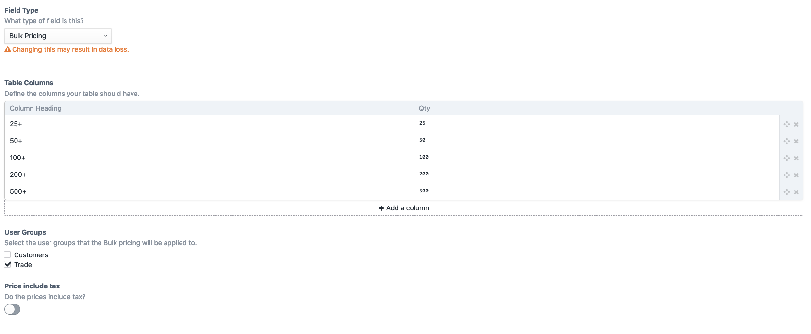
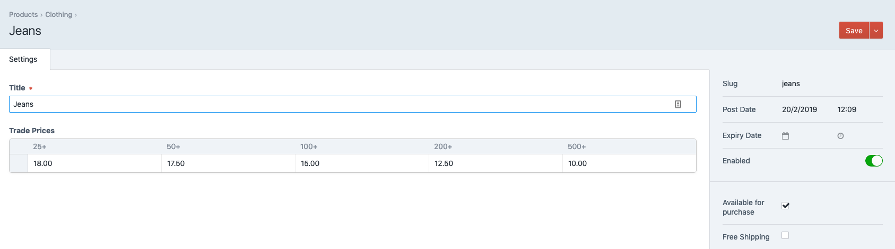
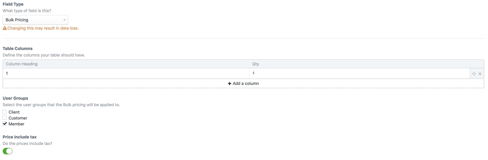
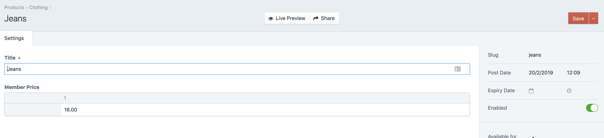

# Commerce Bulk Pricing plugin for Craft CMS 4.x & 5.x

A Craft fieldtype for setting product prices based on the quantity purchased and/or by user group

## Requirements

This plugin requires Craft CMS 4.0 or 5.0 (or later) and Craft Commerce 4 or 5.

## Installation

To install the plugin, follow these instructions.

1. Open your terminal and go to your Craft project:

        cd /path/to/project

2. Then tell Composer to load the plugin:

        composer require webdna/commerce-bulk-pricing

3. In the Control Panel, go to Settings → Plugins and click the “Install” button for Commerce Bulk Pricing.

## Commerce Bulk Pricing Overview

**Bulk Prices**

Create a Bulk Pricing fieldtype, add your column headers (e.g. 25+, 50+ 100+) and set the required quantity a customer must purchase to receive that price.

There are additional options to restrict the prices to certain user groups and to specify if the prices set include tax.



Add the Bulk Pricing field to a product and set the price for each quantity bracket



**User Group Prices**

The fieldtype can also be used to set a price for certain user groups.

Create a fieldtype with a quantity of 1, the same price is used regardless of quantity purchased



Set the product price for that user group



## Templating

`craft.bulkPricing` gives a template the prices the cart will charge, sales included, so a product page never has to read the field's raw value.

**The price at a quantity**

```twig
{{ craft.bulkPricing.price(variant, 25)|commerceCurrency(cart.paymentCurrency) }}
```

This is the unit price for that quantity: the matching price break after any sales, or the variant's normal sale price when no break applies.

**The price breaks**

```twig

    {{ row.heading }}: {{ row.salePrice|commerceCurrency(cart.paymentCurrency) }}

```

Each row has `heading` (the column heading, translated), `qty`, `price` and `salePrice` (after sales), lowest quantity first. Blank cells are left out.

Both take options as their last argument — `price(variant, qty, {…})`, `rows(variant, {…})`:

| Option | Default |
|---|---|
| `currency` | The cart's payment currency when there is a cart, otherwise the primary currency |
| `user` | The signed-in user; pass `null` for a guest |
| `field` (`rows` only) | The last bulk pricing field the user may use; pass a handle to choose one |

User group restrictions and the guest setting apply exactly as they do in the cart. Discounts do not: they belong to the order, so a price shown this way is before any discount.

## Events

`BulkPricingService::EVENT_APPLY_BULK_PRICING` is raised after the plugin has worked out a line item's price, inside Commerce's populate-line-item step. Listen to it rather than to `LineItems::EVENT_POPULATE_LINE_ITEM` when you need the price the plugin set.

```php
use webdna\commerce\bulkpricing\events\ApplyBulkPricingEvent;
use webdna\commerce\bulkpricing\services\BulkPricingService;
use yii\base\Event;

Event::on(
    BulkPricingService::class,
    BulkPricingService::EVENT_APPLY_BULK_PRICING,
    function(ApplyBulkPricingEvent $event) {
        if ($event->applied) {
            $unitPrice = $event->lineItem->getSalePrice();
            // $event->row (qty, price, salePrice), $event->field, $event->order
        }
    }
);
```

It is raised every time Commerce populates a line item (more than once for a new one), with `applied` false when no bulk price applied. The order's totals are not recalculated yet at this point, so read the line item, not the order.

Brought to you by [webdna](https://webdna.co.uk)
